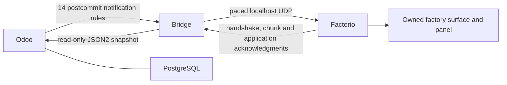

# Architecture

Odoo is authoritative. The Community addon exports one company's warehouse
scope over bearer-authenticated JSON2 using a dedicated effective read-only
user. The bridge validates a complete snapshot, stores its last success in
SQLite and delivers it over localhost UDP. The mod creates an operational
view on its owned `odoo-factory` surface; game actions never write Odoo.

PostgreSQL has no host publication. Odoo publishes `127.0.0.1:8069`; their
private network is `172.28.0.0/24`. A rootful Linux host-network bridge binds
HTTP at `172.28.0.1:8765` and UDP at `127.0.0.1:34200`. The separate local game
listens at `127.0.0.1:34199` via `--enable-lua-udp 34199`. Shared ownership labels
and Compose project labels protect persistence/reset targets.

[Snapshot v1](../contracts/snapshot-v1.schema.json) includes database UUID,
company/warehouse scope, source-read timestamp, work centers, MOs, WOs, BOMs,
products, component demands and stock. Nonterminal MOs plus seven days of
terminal history are included, retaining selected split groups. The adapter
uses Odoo 20 source fields and distinguishes recorded operation output, MO
reported output and posted finished-product moves. Work-order `blocked` means
dependency attention; it does not by itself prove a material shortage. Center
`working_state=done` is mapped to In Progress. Reserved, picked/consumed,
posted, free stock and unreserved demand remain separate facts.

Native create/write automations cover centers, MOs, WOs, productivity/loss,
BOMs/lines/operations, products/templates, units, moves/lines and quants.
They send metadata only after commit to `/odoo/events/<webhook-token>`.
The bridge returns 202 without waiting for source reads, debounces for 250ms
with a one-second cap and serializes reads. Startup, reconnect and a 60-second
reconciliation fetch full scope; lost webhooks/deletes/time-dependent facts are
recovered by reconciliation. Failed reads retry at 1,2,4,8,16,30 seconds while
retaining the last successful snapshot and its original timestamp.

Protocol v1 negotiates hello → bridge challenge UUID → final hello → ack,
then session-scoped monotonically increasing snapshot revisions. UDP envelopes
are at most 1024 UTF-8 bytes; snapshots at most 256KiB/512 chunks. At most eight
chunks are unacknowledged and 100 data frames are emitted per second. One-second
retries stop after eight attempts; session retry/assembly expiry is ten seconds.
Complete JSON/schema/reference/quantity validation precedes atomic application.
Duplicates, reordering and old sessions cannot partially replace accepted data.
The receiver also checks raw JSON shape and exact decimal quantity semantics
before rendering with deterministic center-ID slots and mod ownership checks.

Heartbeats occur every five seconds, sessions time out after fifteen seconds,
and source data older than ninety seconds is stale. Paused game ticks cannot
advance wall-clock freshness. Resume/reload keeps accepted data but starts
resynchronizing; four strictly increasing current-session heartbeats and source
read time matching the snapshot establish health (up to twenty seconds).
This assumes trusted local transport; possession of the pairing token permits
forged transport data and is not adversarial replay protection. The bridge
retains at most 4096 confirmed nonce digests per lifetime and fails closed at
that limit; restart resets connection history, not Odoo authority.

The API key stays in outside-git bridge configuration, the webhook token only
in administrative Odoo/bridge settings, and the pairing token only in local
bridge/game settings. The shared `factorio_connect_common` redactor handles
webhook paths/bearer values in both processes. See [the approved design](superpowers/specs/2026-10-09-factorio-odoo-mrp-design.md)
for the full protocol and security contracts.
