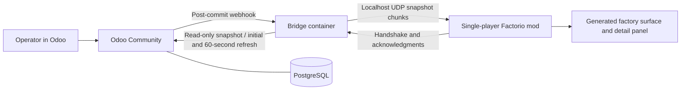

# Odoo MRP operational visualization in Factorio

Date: 2026-10-09

Status: written specification approved by the user on 2026-10-09. The user
approved the design scope through grilling rounds Q1–Q14 and approved the
written artifacts by asking to continue. This document specifies future
implementation; runtime behavior has not yet been tested.

## Intent and agreed scope

An operator opens Factorio and sees the production workflow and recorded status
of a factory managed in Odoo MRP. A change in Odoo updates the view automatically.
The operator can identify active operations, queued work, reported production,
posted output, unfinished dependencies, and unavailable materials.

The first delivery is a reproducible local demo of a fictional pump factory.
Odoo is authoritative. Factorio actions never change Odoo manufacturing orders,
inventory, or work-order status. The view does not simulate capacity or predict
physical production. Power, fuel, recipes, and Factorio inventories cannot
override Odoo's displayed status.

Agreed choices:

- Self-hosted Odoo Community and a separately installed single-player Factorio.
- Work centers become automatically generated stations on a dedicated surface.
- Show operation status and quantities, plus BOM and material information.
- Odoo webhooks trigger reads; reconcile the complete scope every 60 seconds.
- Connect the bridge to the game through localhost UDP, without a game server.
- Linux is the first supported walkthrough platform.
- Specify every demo record and its expected result, with reproducible setup,
  verification, troubleshooting, and reset documentation.

Planning simulation, writeback, real equipment telemetry, exact physical layout,
Enterprise Quality workflows, Space Age, multiple companies, remote hosting,
multiplayer, and platform-specific macOS/Windows networking are outside this
delivery. Inspection is an ordinary Community MRP operation.

## Baseline and proposed repository boundaries

| Component | Target | Responsibility |
| --- | --- | --- |
| Odoo | 20.0 Community | Manufacturing, stock, automated webhook actions |
| PostgreSQL | 17 | Odoo persistence |
| Integration addon | `factorio_connect` | Read-only snapshot method, scope and webhook configuration |
| Demo addon | `factorio_connect_demo` | Fixtures, workflow seeding, scenario assertions |
| Bridge | Python 3.12; HTTP service, JSON validation, SQLite | Notifications, snapshot reads, reconciliation, UDP delivery |
| Factorio | 2.0.77 baseline; base game only | Single-player mod, UDP reception, generated surface and GUI |
| Local orchestration | Docker Engine and Compose v2 on Linux | Odoo, PostgreSQL, bridge and persistent volumes |

The exact Odoo build, container image digests, and Python dependency versions
must be locked before runtime acceptance. No moving `latest` image is allowed
in the delivered reproducible demo. Version compatibility is checked at startup;
unsupported majors produce an actionable error.

The official [Odoo build index](https://nightly.odoo.com/) and
[Factorio API version index](https://lua-api.factorio.com/) are the release
references. API facts in this specification were checked against Odoo's `20.0`
source. Factorio implementation must use the pinned 2.0 API, since the unversioned
`latest` documentation can describe an experimental release.

Proposed implementation boundaries are `odoo-addons/factorio_connect/`,
`odoo-addons/factorio_connect_demo/`, `bridge/`, `factorio-mod/`, `deploy/`,
`scripts/`, and `docs/`. These directories are deliverables, not existing code.

## Architecture and local networking

PostgreSQL and Odoo use a private Compose network. Odoo publishes its HTTP port
as `127.0.0.1:8069:8069`; PostgreSQL has no published host port. The bridge uses
Linux `network_mode: host`, allowing its UDP socket to share the game's host
localhost. This is a Linux-specific design choice, not a generic Docker Desktop
promise.

| Connection | Demo default |
| --- | --- |
| Odoo browser and bridge reads | `http://127.0.0.1:8069` |
| Compose service network | `172.28.0.0/24`, gateway `172.28.0.1` |
| Bridge webhook/health listener | `172.28.0.1:8765` |
| Odoo webhook URL | `http://172.28.0.1:8765/odoo/events/<webhook-token>` |
| Bridge UDP listener | `127.0.0.1:34200` |
| Factorio Lua UDP listener | `127.0.0.1:34199` |
| Factorio launch option | `--enable-lua-udp 34199` |

The bridge HTTP listener binds the private Docker gateway address, rather than
all host interfaces. Compose creates the network before starting the bridge.
Subnet, gateway, HTTP port, and UDP ports are configurable; the walkthrough
includes conflict diagnosis and updating both sides consistently.

Factorio's documented UDP facility sends to localhost and requires explicit
enablement. Pausing or saving can overflow its receive buffer, so delivery cannot
rely on a packet arriving once. See
[LuaHelpers UDP behavior](https://lua-api.factorio.com/latest/classes/LuaHelpers.html)
and [launch options](https://wiki.factorio.com/Command_line_parameters).

## Odoo snapshot and permissions

Use a small integration addon to expose
`POST /json/2/factorio.factory/get_snapshot`. The public model method is
`@api.model` and `@api.readonly`. It reads all required models using the same
Odoo environment and cursor; it performs no commits, opens no additional
cursors, and writes no revision or access-tracking records.

This addon provides an export and configuration seam, not a custom webhook
delivery queue. One call avoids combining unrelated model reads from different
transactions. Community's JSON-2 controller supports bearer authentication and
read-only model methods; Odoo configures repeatable-read transactions.
[JSON-2 controller](https://github.com/odoo/odoo/blob/20.0/addons/rpc/controllers/json2.py),
[method decorators](https://github.com/odoo/odoo/blob/20.0/odoo/orm/decorators.py),
[transaction configuration](https://github.com/odoo/odoo/blob/20.0/odoo/sql_db.py).

A dedicated API user belongs to a custom read-only integration group. Its ACLs
and record rules allow only the configured company, warehouse, manufacturing
data, products, calendars, BOMs, relevant stock records, and productivity data.
Do not assign normal manufacturing/inventory groups that grant write rights.
Verify effective permissions, since ACL grants combine. The export uses no
blanket `sudo()`. Demo seeding and webhook configuration run separately with
administrative permissions.

The local database is named `factorio_demo`. Requests use
`Authorization: Bearer <api-key>` and `X-Odoo-Database: factorio_demo`; snapshot
arguments never authorize a different company/warehouse. The method explicitly
checks integration-group membership, applies the configured scope, and checks
the user's allowed companies before reading underlying models.

The bridge owns the Odoo API key and webhook token. Neither goes into the mod,
the Factorio save, or committed fixture data. Generate a separate local pairing
token for UDP; that token can be present in the local mod setting/save. Document
generation, configuration, expiration/rotation, and redacted logging. Odoo's
built-in webhook action logs its target URL, so the integration addon installs a
logging-handler redaction filter for webhook token paths, including exception
messages; bridge access/error logging applies the same rule. Verify redaction
on successful, failed, and rolled-back deliveries.

The configured export scope is one company and its warehouse's internal stock
locations. Include all nonterminal MOs, terminal MOs completed/cancelled in the
last seven days, their WOs and component moves, relevant active BOMs/products,
and all active work centers. Include complete split groups for selected MOs
where needed, even if a sibling falls outside the terminal time window. Every
snapshot is authoritative for that explicitly identified scope.

## Data contract and truthful status

All IDs are source identifiers scoped by Odoo database, company, and model.
Demo XML IDs help reproducibility; production operation never requires them.
Quantities include units and precision; timestamps use UTC ISO 8601. Missing
values remain unknown, rather than becoming zero or an invented status.

The normalized snapshot contains:

| Collection | Required information |
| --- | --- |
| Metadata | Schema version, database/scope identity, source-read time, source versions |
| Work centers | ID, name/code, active flag, capacity, calendar, raw working state |
| MOs | Reference, product/unit, requested quantity, reported output, posted output, raw state, dates, reservation/availability, production group/backorder sequence |
| WOs | MO/center/operation IDs, sequence, dependency IDs, raw state, operation output, remaining/ready/carried quantities, expected/elapsed time |
| BOMs | Output product/unit/quantity, component quantities, operation graph |
| Material demand | MO/move/product IDs, demand, reserved quantity, recorded consumption, unreserved demand, locations and availability evidence |
| Stock | Product/location/unit, on-hand quantity, reserved quantity, free quantity |

Odoo 20 uses `uom_id` on MOs and stock moves. WO states are `blocked`, `ready`,
`progress`, `done`, and `cancel`; retain raw values alongside display labels.
A center's `working_state='done'` denotes an operation in progress, rather than
completed production. The adapter must map the source model explicitly.
[Work-center source](https://github.com/odoo/odoo/blob/20.0/addons/mrp/models/mrp_workcenter.py),
[work-order source](https://github.com/odoo/odoo/blob/20.0/addons/mrp/models/mrp_workorder.py).

Keep operation readiness, material reservations, and dependency blocking
separate. `blocked` does not establish a material shortage; a ready operation
does not establish full material availability. Show the actual missing component
or predecessor when supported by source data; otherwise show the raw status and
an unavailable explanation.

For live component moves, normalize quantities to the component unit. Separate
reserved move-line quantities from picked/consumed quantities and posted done
moves. `unreserved_demand = max(remaining_demand - reserved, 0)` is labelled
unreserved demand, not automatically a forecast shortage. The shortage warning
also uses Odoo availability/forecast evidence. Do not equate every `stock.move`
quantity with a reservation, or global free stock with stock available to a
particular MO. [Stock-move source](https://github.com/odoo/odoo/blob/20.0/addons/stock/models/stock_move.py).

Odoo MO `qty_produced` is reported output and can include picked output before
posting; posted output is separately derived from done finished-product moves.
Partial completion changes the original MO quantity and creates a backorder.
Expose actual siblings/group references and backorder sequence, without
inventing a direct parent pointer. WO time progress is distinct from quantity
progress. [Manufacturing-order source](https://github.com/odoo/odoo/blob/20.0/addons/mrp/models/mrp_production.py).

The quantity bar uses output versus required operation quantity, accounting for
carried output in backorders. Time and production percentages have separate
labels. Do not sum quantities for different products/units into a center-wide
percentage. The GUI shows each order separately; group totals are allowed only
for compatible products/units and must identify the source grouping.

## Webhook behavior and reconciliation

Install `base_automation` and configure create/update rules for work centers,
MOs, WOs, BOMs/lines/operations, products/units, productivity records/losses,
component/finished stock moves, move lines, and stock quants in the configured
scope. Configure no selected business fields: built-in metadata `_model`, `_id`,
and `_action` identifies the changed record and automation. Notifications signal
a refresh rather than carrying authoritative business state.

Use built-in post-commit webhook actions. They attempt delivery once and log
failure; the bridge must not assume a durable notification stream.
[Community automation manifest](https://github.com/odoo/odoo/blob/20.0/addons/base_automation/__manifest__.py),
[webhook action](https://github.com/odoo/odoo/blob/20.0/odoo/addons/base/models/ir_actions.py).

The bridge authenticates the URL token, validates a bounded payload, marks its
scope dirty, and returns `202` within 250 ms during healthy local operation.
Odoo callback processing must not wait for a snapshot read or a game response.
Coalesce notification bursts for 250 ms, with a maximum one-second wait before
starting a refresh. Serialize reads; changes arriving during a read cause a
subsequent refresh. Concurrent reconciliation and event refreshes cannot publish
an older read after a newer one.

Read immediately on bridge startup, game handshake, and reconnect. Run a full
read every 60 seconds after the previous reconciliation start. On read failure,
retry with delays of 1, 2, 4, 8, 16, then 30 seconds, retaining the last success;
rate-limit repeated errors. A recovered read replaces the complete snapshot.

Deletes, direct stock maintenance, nonstored computations, and time-dependent
information can escape create/update actions. Reconciliation is required even
when webhook delivery appears healthy. Removed/archived records disappear or
become archived only after a complete authoritative snapshot is accepted.

## UDP protocol and recovery

Protocol v1 has `hello`, `hello_ack`, `snapshot_begin`, `snapshot_chunk`,
`chunk_ack`, `snapshot_applied`, `heartbeat`, `heartbeat_ack`, and
`resync_request` messages.
Every envelope identifies its protocol, pairing token, negotiated session,
source scope, and snapshot revision where applicable. Session changes require
a handshake response to the current request; old-session packets are ignored.
Snapshot revisions increase within a session. Duplicates are harmless, and
lower revisions never replace newer data.

The bridge persists its last successful source snapshot in SQLite. Restarted
delivery performs a new handshake and a fresh source read. Cached content can
be shown during a source outage with its original source-read time; rereading
the cache never refreshes its business-data freshness.

Requirements:

- JSON UDP envelopes are at most 1,024 UTF-8 bytes each. Split snapshot text on
  valid UTF-8 boundaries, accounting for JSON escaping and envelope overhead.
- The assembled snapshot is at most 256 KiB and 512 chunks. Oversized exports
  return an actionable scope/size error, retaining the last view.
- Permit at most eight unacknowledged chunks and 100 outgoing data frames per
  second. Retry unacknowledged chunks after one second, at most eight attempts;
  after failure retry the session with a ten-second delay.
- Assemble by snapshot ID/index; require all chunks, declared byte length,
  valid JSON, supported schema, complete references, and valid quantities before
  committing. Expire incomplete assemblies after ten seconds.
- Replace normalized state atomically after validation, then reconcile rendered
  entities. Never show a mixture of old and partially delivered business data.
- A newer snapshot may supersede an incomplete older assembly. Apply/save only
  the latest complete version. A missing application acknowledgment causes a
  harmless repeat, not duplicated stations or production.
- The mod calls UDP reception during running ticks. On load/resume or recovery
  from a heartbeat timeout, request a full latest snapshot.

Send a heartbeat every five seconds, including source-read time, current source
age, and source/transport health. The mod acknowledges each heartbeat; the bridge
invalidates a session after 15 wall-clock seconds without a heartbeat response,
so a paused client's recovery uses a new handshake and latest snapshot.
A failed Odoo connection is displayed
immediately when the bridge reports it. Business data older than 90 seconds is
marked stale. If no bridge heartbeat arrives for 15 seconds of running game
time, show disconnected and mark the retained view stale.

Factorio cannot run mod updates while paused. Freshness indicators cannot
advance during that pause. Compare the advancement of `ticks_played` and `tick`
to detect tick pauses and invalidate the local session on resume; the former
advances during a tick pause. Once updates resume, show resynchronizing until
the current handshake/heartbeat and latest snapshot establish health. A frozen
pause screen itself can retain its previous indicator. The UI must not claim
wall-clock freshness using game ticks alone. Save/load retains the last view,
but reload begins unverified until the handshake completes.
[Game tick semantics](https://lua-api.factorio.com/latest/classes/LuaGameScript.html).

## Factorio visualization

Generate `odoo-factory` as a dedicated, peaceful display surface. Register a
small fixed set of station prototypes using base-game assets, plus a generic
station for arbitrary new work centers. Runtime Odoo products/centers become
labels and data, not dynamically declared Factorio item prototypes.

Use deterministic slots keyed by source work-center ID. Initial demo placement
is Machining → Assembly → Inspection → Packing. Allocate new centers without
moving existing stations. Protect generated entities from mining/destruction,
and modify only entities owned by this mod. Repeated snapshots, reloads, and
renames preserve station identity.

Represent operation dependencies and BOM supply relationships as labelled
workflow connections with belt visuals. They indicate intended workflow, not
observed stock transport. Center links deduplicate repeated routes; product and
order-specific detail remains in the panel. Cyclic dependencies or incomplete
references show a data warning instead of breaking layout or dropping the view.

Each station shows its name, running-order count, ready-order count, dependency
waiting count, and material-warning count. Use text/icons with color: green for
running, blue for ready, amber for dependency/material attention, gray for idle
or terminal history. Display the raw center status separately so mixed work and
an availability block are not flattened into a misleading single state.

Selecting a station opens order references, products, operation/quantity details,
dates, material demand/reservations, and source status explanations. Completed
and cancelled records appear in history, excluded from active queues. Provide a
legend, jump-to-surface action, and global synchronization/freshness indicator.
The operator can open the corresponding Odoo record URL.

Visual pulses, lamps, and quantity bars follow the accepted snapshot. Do not
run native production recipes or modify displayed quantities between snapshots.
Game power loss cannot alter the recorded operational state.

## Seed and documentation deliverables

The companion [seed-data specification](2026-10-09-factorio-odoo-mrp-seed-data.md)
is normative. It enumerates the ten products, two BOMs, four centers, eight
resulting MOs, 22 WOs, inventory/reservation balances, integration configuration,
and supported workflow actions. It distinguishes opening inventory from final
stock after completed production. No raw SQL or direct computed-state writes
may manufacture the desired statuses.

The implementation must deliver:

| Document | Required contents |
| --- | --- |
| README | Project purpose, compatibility, prerequisites, links, shortest verified demo path |
| `docs/local-demo.md` | Linux setup, pinned images, generated secrets, Compose startup/health, Odoo bootstrap, seed loading/verification, mod packaging/install, launch flag and pairing |
| `docs/demo-walkthrough.md` | Baseline expectations, start/finish operation, resolve shortage, inspect backorder, verify each change in Factorio, outage recovery |
| `docs/architecture.md` | Snapshot scope/schema, state mapping, Odoo addon/API, webhook dependency coverage, UDP protocol and freshness semantics |
| `docs/troubleshooting.md` | Port/subnet conflicts, wrong mod/client version, missing UDP flag, permissions/key expiry, webhook failure, pause/buffer loss, stale data, invalid/large snapshot |
| `docs/reset.md` | Nonmutating seed rerun, demo-volume identification, explicit demo-only reset command, backup and restoring baseline |

Commands in the final guide must run from a clean checkout and state their
expected output. Separate package/build requirements from game-client ownership
and installation. Store generated secrets outside git, redact logs, and never
print tokens in example output. Reset targets only project-labelled demo data;
normal start/seed never removes an existing database or save.

## Acceptance and verification

Runtime acceptance is required during implementation; source inspection and
seed arithmetic alone do not prove it. Relevant checks are:

1. From a clean supported Linux checkout, follow the documentation to start
   Odoo/database/bridge, seed the database, install the mod, and load the local
   game. All required commands and version checks succeed.
2. Verify all companion seed assertions, including eight MOs, 22 WOs, the 4+6
   split, 14 posted pumps, and the six-motor shortage. Rerunning seed changes
   neither counts nor posted inventory.
3. A first snapshot creates four correctly labelled stations and the intended
   workflow/material edges, with matching operation states and quantities.
4. Committed Odoo work-order and stock changes appear within five seconds in
   the healthy, unpaused local seeded demo. This is a bounded demo acceptance
   target, not a general production SLA. A rolled-back change is never shown.
5. Suppress one webhook and verify reconciliation corrects the view within
   65 seconds of the change while the game is running.
6. Drop, duplicate, reorder, and truncate UDP packets; reject malformed,
   oversized, wrong-token/session/schema, or dangling-reference snapshots.
   Previous valid state stays intact; eventual delivery produces one station
   per center with no rollback to an older revision.
7. Pause/save/reload the game, restart the bridge, and stop/restart Odoo. Verify
   stale/disconnected/resynchronizing states and complete recovery. A cached
   resend never presents itself as a fresh source read.
8. Add/rename/archive a center and alter a BOM. The view reconciles without
   duplicate entities or touching unrelated game entities.
9. Remove game power/materials and verify Odoo-driven status remains correct.
   Cancelled orders leave active queues and remain in terminal history.
10. Verify the integration API key cannot create/write/delete business records,
    snapshots respect company rules, and secrets are absent from payloads/logs.

Use Odoo integration tests for workflows, snapshot consistency/permissions, and
automation callbacks; bridge tests for coalescing, reconciliation, normalization
and UDP recovery; a real Factorio smoke run for surface/GUI/save-load behavior.
The implementation report must distinguish automated evidence, actual game
verification, and any unexecuted checks.

## Review and next stage

This specification and its seed companion are approved. The
[implementation plan](../plans/2026-10-09-factorio-odoo-mrp.md) is the next review
artifact, including selection of the execution method under the Superpowers
writing-plans workflow. The current delivery does not claim a running mod or a
provisioned Odoo instance.
